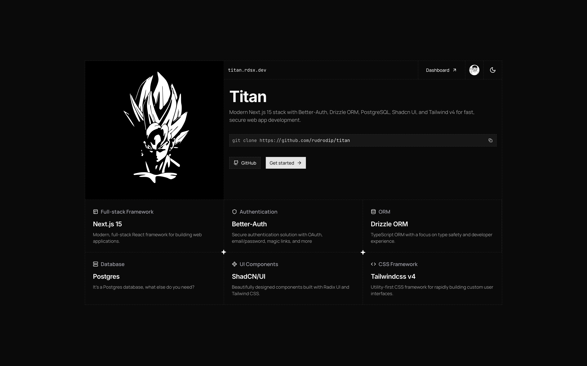

# Titan

Next.js 15 fullstack template with better-auth for authentication and drizzle-orm as the ORM.



> [!WARNING]
> This project uses Next.js 15-canary to support node runtime on middleware. This is not yet supported in stable version.

## Tech Stack

- Full-stack framework: Next.js 15-canary
- UI: Tailwind CSS v4
- Component library: Shadcn UI
- Authentication: better-auth
- Database: postgres
- ORM: drizzle-orm

## Features

- Authentication
  - Social login
    - Google
    - Github
    - Discord
- Database
  - Postgres (Neon)
  - ORM: drizzle-orm
- Next.js API, server actions, and middleware

## Getting Started

1. Clone the repository

```bash
git clone https://github.com/rudrodip/titan.git
```

2. Install dependencies

```bash
bun install
```

3. Start PostgreSQL and create the local environment file

```bash
docker compose up -d
cp .env.example .env
```

Set `BETTER_AUTH_SECRET` in `.env` to a random secret (for example, run `openssl rand -base64 32`). `BETTER_AUTH_URL` is the local app URL, and `DATABASE_URL` uses the PostgreSQL username, password, database, and host port from `docker-compose.yml` (`postgres`, `postgres`, `titan`, and `5436`). The GitHub and Google client IDs and secrets are optional; to enable either provider, fill in both values and register `http://localhost:3000/api/auth/callback/github` or `http://localhost:3000/api/auth/callback/google` as its OAuth callback URL.

4. Apply the included database migration

```bash
bun run db:migrate
```

5. Run the development server

```bash
bun dev
```

6. Open the browser and navigate to `http://localhost:3000`

## Google Calendar

The app remains usable without signing in. Google sign-in only supplies identity, name and avatar; it no longer requests Calendar access or offline user consent. Signed-in users manage sync in the avatar popover. Calendar access uses a server-side service account and a private calendar that you share with it.

Setup:

1. Enable **Google Calendar API** in the service account's Google Cloud project.
2. Create a service account and download its JSON key. Keep it server-side, for example at `.secrets/google-calendar.json` (this directory is ignored by Git).
3. In your own Google Calendar account, create a private **Doen** calendar. Share it with the key file's `client_email`, granting **Make changes to events**. The app does not create a calendar on the service account's behalf or use domain-wide delegation.
4. Copy the calendar's **Calendar ID** from its settings. Set the following in `.env`:

   ```dotenv
   GOOGLE_SERVICE_ACCOUNT_FILE=.secrets/google-calendar.json
   GOOGLE_CALENDAR_ID=your-calendar-id@group.calendar.google.com
   ```

5. For profile sign-in, keep `GOOGLE_CLIENT_ID` and `GOOGLE_CLIENT_SECRET`, with `http://localhost:3000/api/auth/callback/google` as the OAuth redirect URI (use your actual origin when deploying). No Calendar scopes are needed in the user consent flow.
6. Run `npm run db:migrate` and restart the app. The first signed-in visit after service account configuration initializes sync automatically. If necessary, use **Set up sync** in the popover. Later visits do not retry failed syncs.
7. Set your personal notification defaults on this calendar in Google Calendar. For example, an on-time notification suits the 08:00 entries and task ending markers. To get a five-minute warning for a particular Sometime event, set it there yourself.

The service account uses `calendar.events` and a signed JWT to obtain a short-lived access token, with a server-memory cache. It never reads or refreshes the user's Calendar tokens. See [service account authentication](https://developers.google.com/identity/protocols/oauth2/service-account) and [Calendar scopes](https://developers.google.com/workspace/calendar/api/auth). Only the explicitly configured shared calendar is accessed; missing or read-only sharing stops sync without creating a replacement calendar.

Sync behavior:

- Initial import includes tasks that have not started, ongoing unfinished tasks, and future events; ended tasks and Every day events are excluded.
- Tasks occupy their full duration, plus a separate free entry five minutes before the end. Completing a task removes the future end marker and retains the main record; reopening restores a future marker.
- Sometime keeps its selected time. Someday, Every week and Every month use one free entry at 08:00 in `Asia/Shanghai`. Monthly dates clamp to the last day of short months.
- Notification settings belong to your Google account. Doen does not write reminder overrides, guarantee a particular notification offset, or cancel your personal reminders when a task is completed or sync is paused.
- Changes are durably queued after task/event writes, including AI rescheduling. The server drains the queue after responding. Failures remain pending without scheduled retries; the next mutation or manual sync processes the latest state, including deletions.
- **Sync now** scans Doen's records and queues only changed or not-yet-successful calendar entries. Unchanged tasks and events are skipped, including completed records and elapsed end markers. Google-side edits are overwritten only when the corresponding Doen content changes; unchanged remote edits or deletions are not detected. Disabling the switch only pauses synchronization; existing calendar entries and your reminders stay in place. Re-enabling syncs pending changes. Signing out does not disconnect the service account.
- This is a personal workspace. Calendar controls require the original owner's signed-in session; anonymous task edits continue to sync after initialization. Changing the configured calendar or service account reinitializes local mappings; the old remote calendar is left untouched.

The synchronization implementation lives in `src/lib/google-calendar/`; the UI is in `src/components/google-calendar/`. It adds no dependency or background scheduler. The host must support Next.js `after()` for queue processing. If a process stops mid-sync, pending work waits for the next explicit trigger after the two-minute worker lease expires. Source writes commit before enqueueing, so a crash in that gap requires a manual full sync to recover the missing change.

Run `npm run test:calendar` for planner, service account authentication and queue tests. The runner creates a disposable RSA key, uses an isolated temporary schema in the **local** PostgreSQL database, mocks all Google calls and removes its schema and key afterwards. It never authenticates with Google or changes a real calendar.
